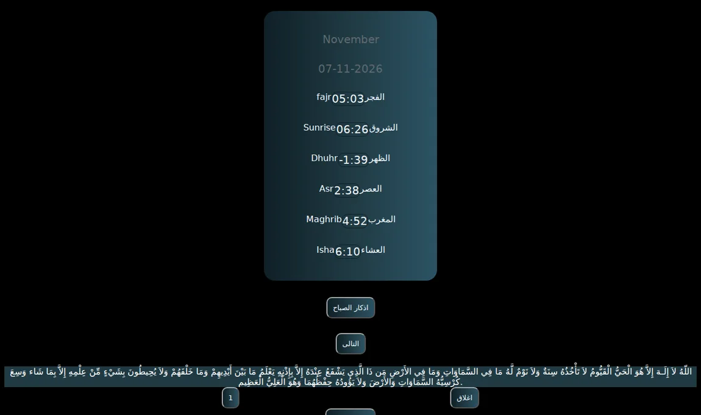

# Salati & Azkar

An early JavaScript exercise that combines Cairo prayer times with a local collection of morning azkar. The reader tracks repetitions before advancing to the next entry.



## Run locally

Serve the repository over HTTP so the browser can load [`Azkar.json`](Azkar.json).

```bash
python3 -m http.server 8000
```

Open `http://localhost:8000`. An internet connection is needed for live prayer times from AlAdhan and for the Bootstrap and SweetAlert2 CDN assets.

**Stack:** HTML, CSS, JavaScript, and Bootstrap. The larger React follow-up is the [Ramadan App](https://github.com/Amr546214/Ramadan-app).
